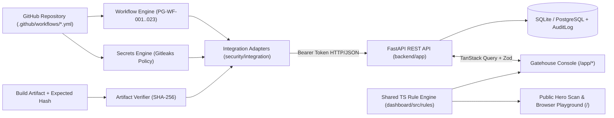

<div align="center">


# PipelineGuard

**Catch risky CI/CD workflow changes, exposed secrets, and tampered build artifacts before they reach production.**


[Live Landing & Playground](#-gatehouse-v2-frontend) · [Architecture](#-architecture) · [Security Scanners](#-security-engines) · [Quick Start](#-quick-start) · [API Reference](#-backend-api)

</div>

---

## Overview

PipelineGuard secures GitHub Actions pipelines end-to-end across three enforcement layers and one unified triage console:

1. **GitHub Actions Workflow Inspection (`PG-WF-001`–`PG-WF-023` + `PG-WF-900`/`901`)** — Detects script injection via untrusted contexts, `pull_request_target` pwn-request checkouts, `write-all` / missing permissions, unpinned action tags, dangerous shell pipes (`curl | bash`, reverse shells, `eval`, cryptominers), network exfiltration domains, and persistent workflow modifications.
2. **Secret Leak Protection (`security/secrets`)** — Wraps Gitleaks rules with PipelineGuard's fail-closed severity policy (`private-key`, `aws-access-token`, `github-pat`, `stripe-access-token`, high-entropy API keys) while masking secret bytes before telemetry leaves the runner.
3. **Artifact Integrity Verification (`security/artifacts`)** — Fail-closed chunked SHA-256 verification against independent expected hashes, generating `CRITICAL` tamper findings on mismatch and verified seals on match.
4. **Gatehouse (v2) Web Platform (`dashboard/`)** — An evidence-first frontend pairing a public interactive **Landing Page + Browser YAML Playground** (`/`) with an **Operations Dashboard** (`/app/*`) backed by FastAPI + SQLite/PostgreSQL.

---

## Architecture



---

## Gatehouse (v2) Frontend

Designed around [DESIGN.md](./DESIGN.md): dark petrol-slate (`#0E181D`) and cool-paper light (`#F4F7F6`) canvases, **Instrument Sans** + **JetBrains Mono** typography, **one brand color** (Verdigris `#5CC9B0` / `#0B6F5F`), **triple-encoded severities** (distinct 12px SVG shapes + tint + text label), and zero idle animation.

| Surface | Route | Highlights |
|---|---|---|
| **Hero Scan Demo & Playground** | `/` | Always-dark YAML panel synced with an orthographic matte WebGL `HeroGateScene` via `heroScanStore`, `50ms` staggered `"Show fix"` reveal, real `crypto.subtle.digest` **`Verified`** Seal, and a Web Worker YAML Playground (`>200` lines). |
| **3D Architecture, Incidents & Rules** | `/#architecture`, `/#incidents`, `/#rules` | Demand-rendered (`frameloop="demand"`) isometric views built from `graph.ts`, `incidentPaths.ts`, and `rules/*` (0 idle GPU frames over 5s), with accessible hidden stage lists, `"Isometric"` / `"Flat"` toggle, and identical 2D fallbacks. |
| **Dashboard Preview (CSS 3D)** | `/#preview` | Three Playwright-captured light/dark `/app` screenshots arranged in `perspective: 1200px` CSS 3D depth layers (`animation-timeline: view()`) with keyboard-focusable hotspots. |
| **Overview** | `/app` | Ranked **"Needs attention"** queue (severity first, then oldest open finding), stacked severity posture bar, plain-text stats, single-series Recharts risk chart with gate threshold, and first-run onboarding when 0 pipelines exist. |
| **Findings & Evidence Drawer** | `/app/findings` | URL-synced severity/status filter chips, `@tanstack/react-table` sticky headers, `28/36/44px` density persistence, `j`/`k`/`Enter`/`Escape` keyboard nav, slide-out YAML evidence + diff drawer, `useOptimistic` updates inside `startTransition`, and 6-second **Undo** toasts. |
| **Incidents, Workflows & Secrets** | `/app/incidents`, `/workflows`, `/secrets` | High/critical active triage workspace, full filterable 23-rule catalog, and masked secret findings + Gitleaks severity table. |
| **Artifacts Verifier** | `/app/artifacts` | Browser-side `crypto.subtle.digest` SHA-256 verifier matching `artifact_verifier.py` (`MATCH · PASS` / `MISMATCH · BLOCK`) with `Verified` Seal, session log, and route-scoped lazy `LedgerArtifactScene3D`. |
| **Pipelines & Progressive Connect** | `/app/pipelines` | React 19 `useActionState` + Zod Connect Repository form: resolves `/api/repositories/resolve` or GitHub public `.github/workflows`, suggests `pipe-<repo>` + branches, validates blur-first with multi-error focus summaries. |
| **Runs, Audit log & Settings** | `/app/runs`, `/audit`, `/settings` | Execution telemetry, append-only status transition trail, live `/api/health` + `/api/test` latency table, theme switcher (`System`/`Light`/`Dark`), and optional JWT sign-in. |
| **Command Palette** | `Ctrl+K` / `⌘K` | `cmdk` dialog searching Recent items, Findings, Pipelines, Pages, and Quick Actions. |

---

## Security Engines

<details>
<summary><strong>1. Workflow Security Rules (PG-WF-001 to PG-WF-023)</strong> — Click to expand categories</summary>

| Category | Rules | Targets |
|---|---|---|
| **Injection** | `PG-WF-001`, `PG-WF-002`, `PG-WF-003` | Untrusted `${{ github.event.* }}` interpolation in `run:`, `actions/github-script`, and `GITHUB_ENV`/`GITHUB_OUTPUT`/`GITHUB_PATH` writes |
| **Permissions** | `PG-WF-004`, `PG-WF-005`, `PG-WF-006`, `PG-WF-007` | Missing `permissions:`, `write-all` / broad write scopes, `pull_request_target` + head checkout pwn-requests, `secrets: inherit` |
| **Commands** | `PG-WF-008`–`PG-WF-011`, `PG-WF-021`–`PG-WF-023` | `curl\|bash`, `base64 -d\|sh`, `eval`, reverse shells, echoed secrets / `set -x`, unverified `chmod +x`, cryptominers |
| **Network** | `PG-WF-012`–`PG-WF-015` | Raw IP downloads, C2/exfiltration webhooks (`ngrok`, `webhook.site`, `pastebin`), plain `http://`, `curl -k`/`--insecure` |
| **Persistence** | `PG-WF-016`, `PG-WF-017`, `PG-WF-018` | Runtime writes to `.github/workflows/`, `git push` with `GITHUB_TOKEN`, unattended `schedule:` workflows |
| **Supply Chain** | `PG-WF-019`, `PG-WF-020` | Unpinned mutable tags (`@v3` instead of 40-char SHA), `actions/checkout` without `persist-credentials: false` |
| **Parser / System** | `PG-WF-900`, `PG-WF-901` | Malformed YAML indentation/structure, file/depth/node limits, isolated detector errors |

</details>

- **Secrets Scanner ([security/secrets/](file:///d:/pipelineguard/security/secrets)):** Maps Gitleaks rule IDs to `CRITICAL` (`private-key`) and `HIGH` (`aws-access-token`, `github-pat`, `github-fine-grained-pat`, `stripe-access-token`, `generic-api-key`) with `BLOCK` enforcement and raw token redaction.
- **Artifact Verifier ([security/artifacts/](file:///d:/pipelineguard/security/artifacts)):** Constant-time comparison (`hmac.compare_digest`) of calculated SHA-256 digests against trusted external references or `sha256sum` files; emits structured `artifact_tampering` events on mismatch.

---

## Project Structure

```text
pipelineguard/
├── backend/
│   ├── app/
│   │   ├── models/              # Pipeline, PipelineRun, SecurityEvent, AuditLog
│   │   ├── routes/              # auth, pipelines, pipeline_runs, security_events, audit_logs
│   │   ├── schemas/             # Pydantic validation schemas
│   │   ├── auth.py              # JWT + Scanner token + localhost loopback read/dashboard auth
│   │   ├── config.py            # Environment & settings loader
│   │   ├── database.py          # SQLAlchemy session (SQLite / PostgreSQL)
│   │   └── main.py              # FastAPI app & CORS configuration
│   ├── seed.py                  # Realistic initial telemetry seeder
│   └── requirements.txt
│
├── dashboard/                   # Gatehouse (v2) React 19 + TypeScript 7 + Vite 8 + Tailwind v4
│   ├── public/                  # favicon.svg, favicon-critical.svg, fonts/*.woff2, images/preview/*.webp
│   ├── scripts/                 # verifyRules.ts, checkManifest3D.mjs, capturePreviewScreenshots.mjs,
│   │                            # verifyPhaseScenes.mjs, verifyPhase7Full.mjs
│   └── src/
│       ├── app/                 # router.tsx (lazy routes), queryClient.ts, theme.tsx
│       ├── features/            # landing (incl. ArchitectureSection, HeroGateSlot), shell, overview, findings,
│       │                        # incidents, workflows, secrets, artifacts, pipelines, runs, audit, settings
│       ├── motion/              # DESIGN.md timing tokens + async LazyMotion domMax provider
│       ├── rules/               # TypeScript rule engine mirroring security/workflow (24 rules + Worker)
│       ├── services/api.ts      # Typed API client with latency metrics & repo metadata fallback
│       ├── styles/tokens.css    # Semantic --pg-* dark & light variables, CSS 3D preview & view() animations
│       ├── three/               # Isolated R3F/Three core primitives, heroScanStore & 6 lazy scenes
│       └── ui/                  # Button, Chip, Kbd, Badge, Seal, Field, Select, Panel, CodePanel,
│                                # Dialog, Drawer, Tabs, Tooltip, ToastProvider, BrandMark
│
├── security/
│   ├── workflow/                # AST/line-aware YAML parser, 23 rules, 6 detectors, SARIF, risk scoring
│   ├── secrets/                 # Gitleaks runner, severity policy, secret masking & event builder
│   ├── artifacts/               # Chunked SHA-256 hasher, fail-closed verifier, tamper events CLI
│   └── integration/             # Scanners -> FastAPI ingestion adapters
│
├── DESIGN.md                    # PipelineGuard Gatehouse (v2) design specification
├── GATEHOUSE_CHECKLIST.md       # Stateful frontend execution checklist & handoff record
├── LIVE_E2E_REPORT.md           # Full live Chrome + API end-to-end verification report
├── FRONTEND_ARCHITECTURE_REPORT.md
└── README.md
```

---

## Quick Start

### Prerequisites
- **Python 3.11+**
- **Node.js 20+** and **npm**
- **Git** *(optional: PostgreSQL for production DB, Gitleaks CLI for local secret scanning)*

### 1. Clone & Configure Backend

```bash
git clone https://github.com/jeevanL16/pipelineguard.git
cd pipelineguard/backend
```

Copy `.env.example` to `.env` (for quick local testing, SQLite works with zero external setup):

```powershell
# Windows PowerShell
Copy-Item .env.example .env
pip install -r requirements.txt
python seed.py
python -m uvicorn app.main:app --host 127.0.0.1 --port 8000
```

```bash
# macOS / Linux
cp .env.example .env
python -m venv .venv && source .venv/bin/activate
pip install -r requirements.txt
python seed.py
uvicorn app.main:app --host 127.0.0.1 --port 8000 --reload
```

Backend endpoints are served at `http://127.0.0.1:8000` (OpenAPI Swagger UI at `http://127.0.0.1:8000/docs`).

### 2. Run the Gatehouse Dashboard

In a second terminal from the repository root:

```bash
cd dashboard
npm install
npm run dev
```

Open **`http://127.0.0.1:5173/`** for the interactive Landing Page & Playground, or **`http://127.0.0.1:5173/app`** for the Operations Dashboard.

### 3. Run Security CLI Modules

```bash
# Scan workflows in this repository
python -m security.workflow .github/workflows/

# Hash and verify a build artifact
cd security/artifacts
python artifact_cli.py hash PATH_TO_FILE
python artifact_cli.py verify PATH_TO_FILE --expected <64_HEX_SHA256>
```

---

## Backend API

| Endpoint | Method | Purpose |
|---|---|---|
| `/api/health` | `GET` | Service health check |
| `/api/test` | `GET` | Frontend-to-backend connectivity verification |
| `/api/auth/login` | `POST` | Exchange dashboard username/password for JWT Bearer token |
| `/api/pipelines` | `GET` / `POST` | List monitored repositories or register a new pipeline |
| `/api/pipelines/{pipeline_id}` | `GET` | Fetch single pipeline metadata |
| `/api/runs` | `GET` / `POST` | List or record pipeline execution telemetry |
| `/api/events` | `GET` / `POST` | List or ingest security findings |
| `/api/events/{event_id}/status` | `PATCH` | Transition status (`OPEN`, `INVESTIGATING`, `RESOLVED`, `FALSE_POSITIVE`) + write `AuditLog` |
| `/api/audit-logs` | `GET` | Retrieve append-only status audit trail |

> **Note:** Localhost loopback access simplifies local development evaluation. Before public deployment, disable loopback auto-auth, provision PostgreSQL + strong Argon2/JWT secrets, and enforce HTTPS.

---

## Verification & Test Suites

Observed local verification results across backend security modules and frontend builds:

| Suite / Check | Result | Command |
|---|---|---|
| **Workflow Security Engine** | `383 passed` | `python -m pytest -q security/workflow/tests --no-cov` |
| **Secrets Security Policy** | `21 passed, 12 skipped` *(Gitleaks CLI integration skipped when binary absent)* | `python -m pytest -q security/secrets/tests --no-cov` |
| **Artifact Integrity Verifier** | `69 passed, 1 skipped` | `python -m pytest -q security/artifacts/tests --no-cov` |
| **FastAPI Backend Smoke** | `2 passed` | `cd backend && python -m pytest -q --no-cov` |
| **Frontend Typecheck, Lint, Unit & Build** | `0 errors` (`15/15` Vitest passed; `248.92 KiB` lazy 3D gz, isolated from `/app`) | `cd dashboard && npx tsc --noEmit && npm run lint && npm test -- --run && npm run build && node scripts/checkManifest3D.mjs` |
| **Browser Rule Engine Fixtures** | `ALL RULE ENGINE FIXTURE TESTS PASSED` | `npx esbuild scripts/verifyRules.ts --bundle --platform=node --format=esm \| node --input-type=module -` |
| **Gatehouse 3D & Live Chrome E2E** | Verified 0 idle GPU frames (5s), 0 console errors across `/` & `/app/*` (`dark`/`light`), fallbacks, keyboard parity, `jeevanL16/eventgenie`, `360px` | `node scripts/verifyPhase7Full.mjs prod` & [LIVE_E2E_REPORT.md](./LIVE_E2E_REPORT.md) |

---

## Documentation Index

- **[DESIGN.md](./DESIGN.md)** — Gatehouse (v2) token, typography, motion, component, and architecture spec.
- **[FRONTEND_ARCHITECTURE_REPORT.md](./FRONTEND_ARCHITECTURE_REPORT.md)** — Frontend architecture, component catalog, animation breakdown, and improvement backlog.
- **[LIVE_E2E_REPORT.md](./LIVE_E2E_REPORT.md)** — End-to-end Chrome + API test execution report (`jeevanL16/eventgenie`).
- **[GATEHOUSE_CHECKLIST.md](./GATEHOUSE_CHECKLIST.md)** — Implementation progress checklist and handoff state.
- **[REQUIREMENTS_COMPLIANCE.md](./REQUIREMENTS_COMPLIANCE.md)** — Problem-statement traceability matrix across security components.

---

<div align="center">
<sub>Repository: <a href="https://github.com/jeevanL16/pipelineguard">jeevanL16/pipelineguard</a></sub>
</div>
